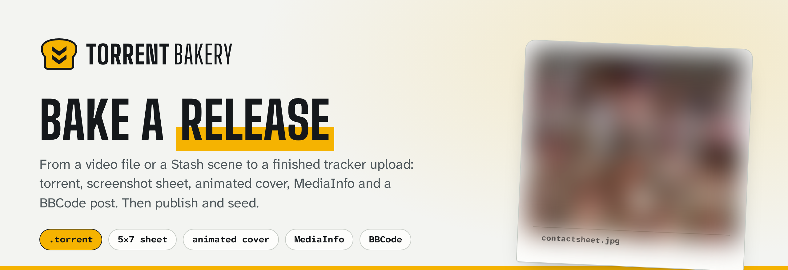
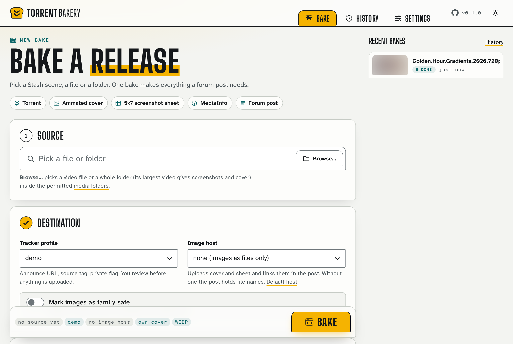
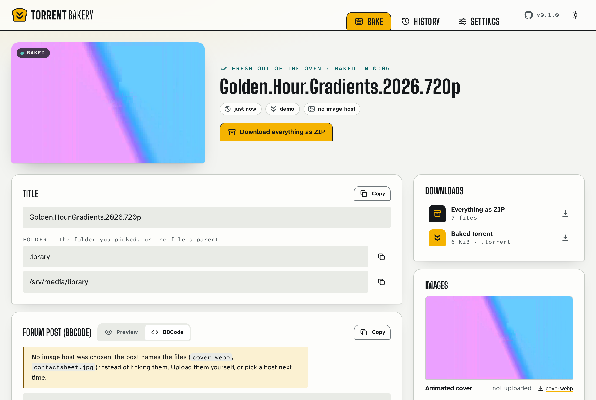
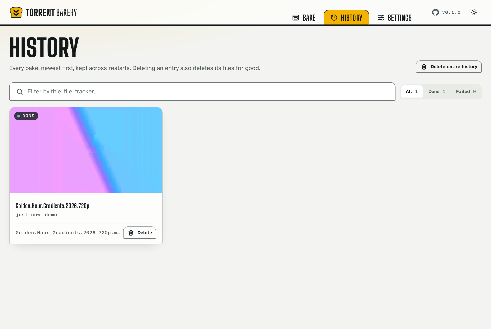
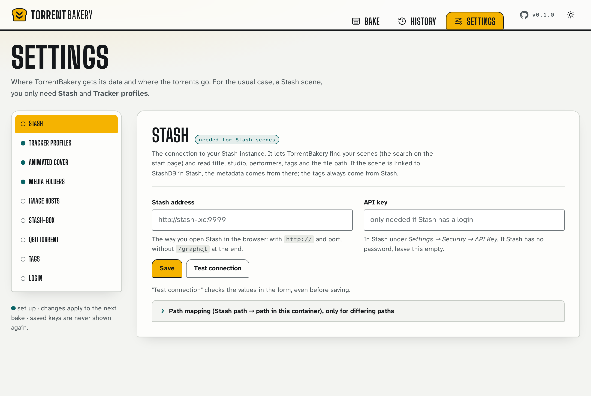

<picture>
  <source media="(prefers-color-scheme: dark)" srcset="docs/assets/banner-dark.png">
  
</picture>

<p align="center">
  <a href="https://github.com/brewing8309/TorrentBakery/releases"></a>
  
  
  <a href="LICENSE"></a>
</p>

<p align="center">
  <b><a href="#-quick-start">Quick start</a></b> ·
  <b><a href="docs/README.md">Documentation</a></b> ·
  <b><a href="docs/tracker-templates.md">Add your own tracker</a></b> ·
  <b><a href="CHANGELOG.md">Changelog</a></b>
</p>

---

**TorrentBakery** turns a video into everything a tracker upload needs, in one go. Pick a Stash scene, a file or a folder, press **Bake**, and you get the `.torrent`, a 5×7 screenshot sheet, an animated cover, the MediaInfo and a ready-to-paste BBCode forum post. If you like, it then fills in the tracker's upload form for you, hands the torrent to qBittorrent and checks that it really seeds.

It runs as a small web app on your own server (an LXC container is ideal), next to your media, and has a full command line (`tb`) as well.

> [!NOTE]
> **100 % vibe-coded.** Every line of TorrentBakery (code, tests, design and these docs) was written by an AI ([Claude Code](https://claude.com/claude-code)) from plain-language instructions; no line was typed by hand. It has automated tests, but read the code before you trust it with your tracker accounts.

## 🍞 What comes out of the oven

| | |
|---|---|
| 🧲 **Torrent** | Private or public, your announce URL and source flag from a tracker profile. A folder becomes one torrent of the whole folder. |
| 🖼️ **Screenshot sheet** | 5×7 thumbnails spread over the runtime, with a header of the file's facts. Size and grid are configurable. |
| 🎞️ **Animated cover** | WebP (or GIF) from 1.5-second clips across the video, or the preview Stash already made. Shrunk automatically below ~9 MB. |
| 📋 **MediaInfo** | The full `mediainfo` report, ready for the post. |
| ✍️ **BBCode post** | Built from a Jinja2 template: title, performers, studio, description, tags, images, file facts. Live preview in the browser. |
| 📦 **Downloads** | Everything as a ZIP, plus each file on its own. Nothing is uploaded unless you choose an image host or press Publish. |

### And the extras
- **Stash & stash-box metadata.** Search your Stash right from the start page. Title, performers, tags, description and cover come from StashDB (or any stash-box) when the scene is linked, otherwise from Stash.
- **Image hosts.** pixhost (.to/.cc/pixho.st), imgbox, imagebam, hamsterimg, imghost.dev, bitporn.eu. The post links the hosted images directly.
- **Publishing.** Gazelle trackers (session cookie, form filled server-side) and UNIT3D trackers (API token). Every upload passes a **review step** first: title, post, tags and category, all editable, categories read live from the tracker.
- **Seeding.** Adds the torrent to qBittorrent, waits for the recheck and only starts it when the files are complete, so it never downloads by accident.
- **Your own trackers.** A tracker is one small TOML file, data only. See [Add your own tracker](docs/tracker-templates.md).
- **History** of every bake that survives restarts, **light & dark theme**, phone-friendly layout, optional **login with TOTP 2FA**.

## 📸 A look inside

<table>
<tr>
<td width="50%"><picture><source media="(prefers-color-scheme: dark)" srcset="docs/assets/bake-dark.png"></picture><p align="center"><b>Bake</b>: source, tracker profile, image host, go.</p></td>
<td width="50%"><picture><source media="(prefers-color-scheme: dark)" srcset="docs/assets/result-dark.png"></picture><p align="center"><b>Result</b>: downloads, post preview, review &amp; publish.</p></td>
</tr>
<tr>
<td width="50%"><picture><source media="(prefers-color-scheme: dark)" srcset="docs/assets/history-dark.png"></picture><p align="center"><b>History</b>: every bake, filterable.</p></td>
<td width="50%"><picture><source media="(prefers-color-scheme: dark)" srcset="docs/assets/settings-dark.png"></picture><p align="center"><b>Settings</b>: everything explained where you set it.</p></td>
</tr>
</table>

## 🚀 Quick start

**You need:** a Debian 12/13 or Ubuntu host or LXC container with Python ≥ 3.11, internet access to pypi.org, and your videos mounted on it. `ffmpeg` and `mediainfo` are installed for you.

### 1. Install
> [!TIP]
> On a Docker host, use the [Docker image](docs/installation.md#docker) instead.

```sh
curl -fLO https://github.com/brewing8309/TorrentBakery/releases/latest/download/torrentbakery-0.1.0.tar.gz
tar xzf torrentbakery-0.1.0.tar.gz
cd torrentbakery-0.1.0 && sudo ./install.sh          # another port: sudo PORT=9000 ./install.sh
```
This creates the service `torrentbakery` (systemd, own user), a venv in `/opt/torrentbakery`, the `tb` command and the data folder `/var/lib/torrentbakery`.

### 2. Open it
Go to `http://<your-host>:8080/`. There is no login yet: either keep it on a trusted network or turn on **Settings → Login & 2FA** first.

### 3. Set up the kitchen (Settings)
1. **Media folders**: add the folders holding your videos (they must be readable by the user `torrentbakery`).
2. **Stash** *(optional)*: address and API key, so you can search scenes and get their metadata. Add a **stash-box** key (e.g. StashDB) for the richest metadata.
3. **Tracker profiles**: add one with your announce URL and source flag. For publishing, pick a tracker template and paste your cookie or API token, then press **Test login**.
4. **Image host** *(optional)*: choose a default, so the post links real images.

### 4. Bake
On **Bake**, search a Stash scene or press **Browse…** for a file or folder, choose the tracker profile and image host, press **Bake**. A few minutes later the result page has the ZIP, the torrent, the images and the post with a copy button.

### 5. Publish *(optional)*
At the bottom of the result page, review title, post, tags and category, then press **Publish**. TorrentBakery uploads to the tracker, adds the torrent to qBittorrent (set it up under **Settings → qBittorrent**) and tells you once it is seeding.

> [!TIP]
> Everything works from the shell too: `tb bake stash:1234 -t mytracker -u pixhost.to`, `tb publish out/My_Release -t mytracker --dry-run`. See the [command line reference](docs/cli.md).

## 📚 Documentation

| | |
|---|---|
| [Installation & updates](docs/installation.md) | Tarball install, Docker image, LXC tips, update, remove, reverse proxy, running from a checkout |
| [Using the web UI](docs/web-ui.md) | Bake, result page, review step, history, settings |
| [Configuration](docs/configuration.md) | Stash & stash-box, path mappings, covers, sheet, image hosts, qBittorrent, tags, `config.toml` |
| [Publishing to trackers](docs/publishing.md) | Gazelle and UNIT3D, cookies and tokens, review step, seeding |
| [Add your own tracker](docs/tracker-templates.md) | Step-by-step guide and full reference for tracker templates |
| [Login & 2FA](docs/security.md) | Optional login, TOTP, recovery codes, what is protected and what not |
| [Security audit](SECURITY-AUDIT.md) | Scope, method and results of the security review |
| [Command line](docs/cli.md) | Every `tb` command with examples |

## 🧑‍🍳 Good to know
- **Your data stays with you.** Nothing leaves your server unless you pick an image host or press Publish. API keys and cookies live only in `/var/lib/torrentbakery/config.toml` (mode 0600) and are never shown again in the UI.
- **Trackers change.** Upload forms of Gazelle sites are read live, so small changes usually just work; when a site changes a lot, its template needs an update. Always try a new tracker with `--dry-run` or the review step first.
- **Status of 0.1.0:** first release. Baking, the StashDB lookup and the image hosts pixhost, imgbox and imagebam are verified live; hamsterimg is implemented but untested (it needs an API key). Publishing ships with templates for HappyFappy (Gazelle) and bitporn (UNIT3D); please report how it works on your tracker.

## 🤝 Contributing
Bug reports, ideas and tracker templates are welcome as [issues](https://github.com/brewing8309/TorrentBakery/issues) or pull requests. A new tracker is usually just one TOML file: see [Add your own tracker](docs/tracker-templates.md). Run the tests with `.venv/bin/pytest -q`.

## 📜 License
[CC BY-NC 4.0](LICENSE): use it, change it, share it, build on it, as you like, as long as you **credit TorrentBakery with a link to this repository** and **do not charge money for it** or use it commercially.

TorrentBakery is not affiliated with any tracker, image host or with Stash. Tag mapping and form field names were inspired by the [stash-empornium](https://github.com/bdbenim/stash-empornium) userscript. Fonts: Big Shoulders Display and Atkinson Hyperlegible (SIL OFL). Only upload what you have the right to share.
