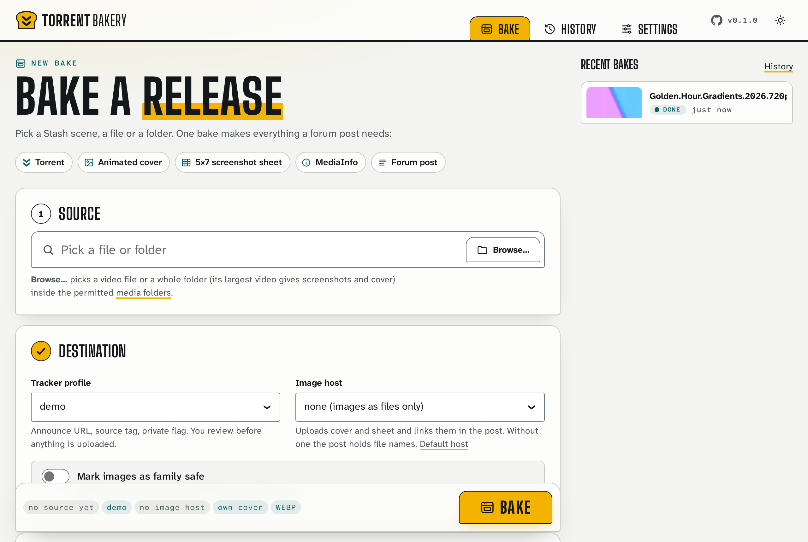
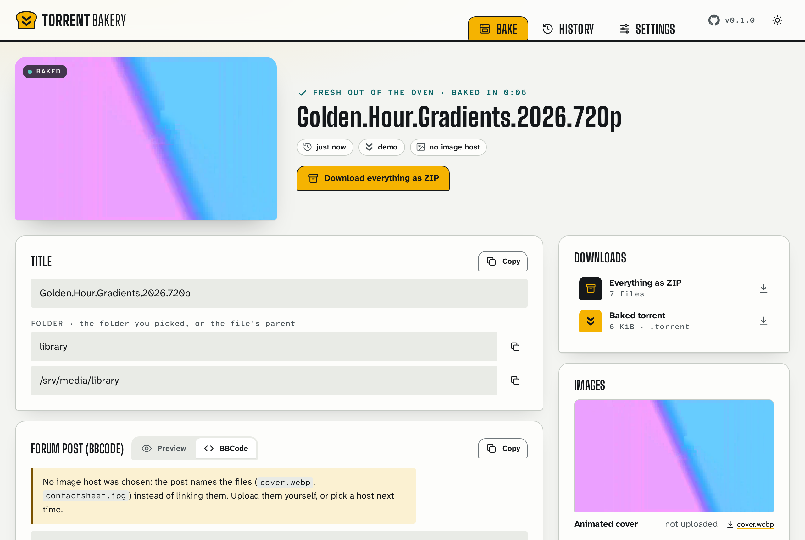
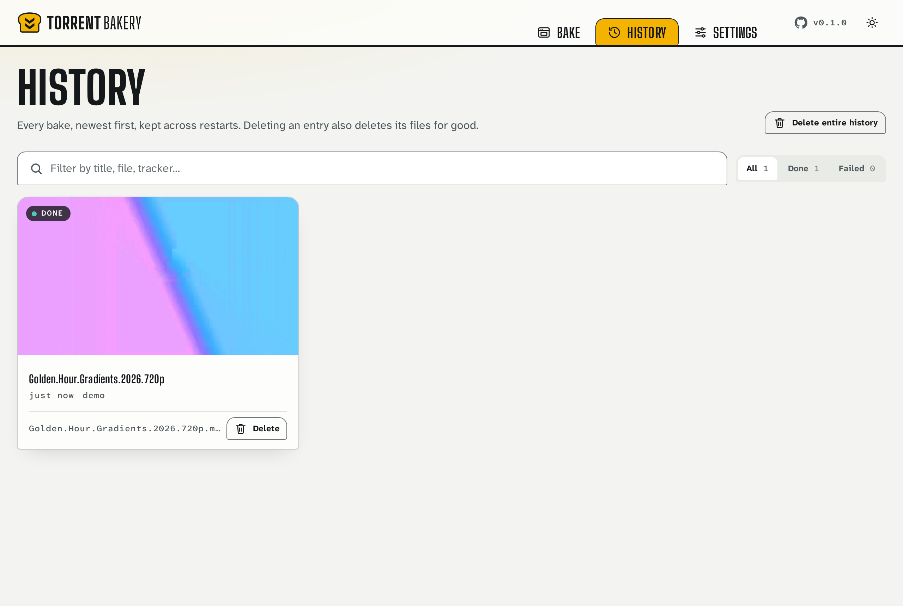
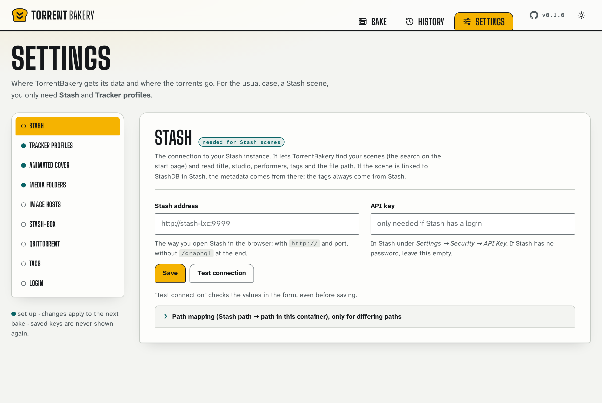
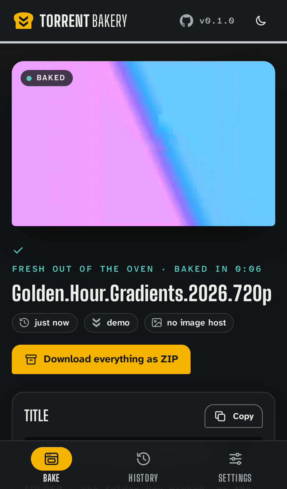

# 🖥️ Using the web UI

[← Documentation](README.md)

Three pages, reachable from the header (on phones from the tab bar at the bottom): **Bake**, **History**, **Settings**. The header also shows the running version (it links here) and the light/dark switch.

## Bake
<picture><source media="(prefers-color-scheme: dark)" srcset="assets/bake-dark.png"></picture>

1. **Source**: type to search your Stash (hits come with pictures), enter a scene ID, or press **Browse…** to pick a file or a whole folder inside your media folders. A folder becomes one torrent; its largest video provides screenshots and cover.
2. **Destination**: the tracker profile (announce URL, source flag, private flag) and the image host. "None" keeps the images as files only; the post then names them and you upload them yourself.
3. **Options**: family-safe flag for uploads, cover source (own animation or Stash's preview) and format (WebP/GIF). A stash-box scene link can be given for plain files.
4. Press **Bake**. The summary bar shows what you chose. The form remembers your last choices.

While it bakes you see each step (fetching the recipe, weighing the ingredients, slicing the loaf, glazing the cover, into the oven, serving the images, plating the post) and the screenshot sheet filling up live. If something fails, **Bake again** retries with the same choices.

## Result
<picture><source media="(prefers-color-scheme: dark)" srcset="assets/result-dark.png"></picture>

- **Downloads**: everything as a ZIP, the torrent, and every image on its own.
- **Title** and **folder** with copy buttons.
- **Forum post**: rendered preview and raw BBCode, with **Copy**.
- **Images**: cover and sheet, with their hosted links if uploaded.
- **Publish** *(when the profile has a tracker template)*: the review step. Title, post, tags and category are filled in and editable; categories are read live from the tracker. Nothing is uploaded until you press **Publish**. Afterwards the page follows qBittorrent until the torrent seeds. See [Publishing](publishing.md).

## History
<picture><source media="(prefers-color-scheme: dark)" srcset="assets/history-dark.png"></picture>

Every bake, newest first, kept across restarts in `<out>/history.jsonl`. Filter by title, file or tracker, or by state (done/failed). Each card opens its result page. **Delete** removes the entry *and its files*; **Delete entire history** empties it.

## Settings
<picture><source media="(prefers-color-scheme: dark)" srcset="assets/settings-dark.png"></picture>

Each section explains itself in place; a dot in the side navigation shows what is set up. Saved keys and cookies are never shown again (a blank field keeps the saved value).

| Section | Details |
|---|---|
| Stash | [Configuration → Stash](configuration.md#stash-and-stash-box) |
| Tracker profiles | [Publishing](publishing.md), [Add your own tracker](tracker-templates.md) |
| Animated cover | [Configuration → Cover](configuration.md#animated-cover) |
| Media folders | the only folders plain files may be baked from and browsed in |
| Image hosts | [Configuration → Image hosts](configuration.md#image-hosts) |
| Stash-box | [Configuration → Stash](configuration.md#stash-and-stash-box) |
| qBittorrent | [Publishing → Seeding](publishing.md#seeding-with-qbittorrent) |
| Tags | [Configuration → Tags](configuration.md#tags) |
| Login & 2FA | [Login & 2FA](security.md) |

## On the phone

The layout adapts down to phone size: navigation moves to a tab bar at the bottom, the bake summary scrolls sideways, and all buttons stay thumb-sized. Add it to your home screen for an app-like icon.
 
